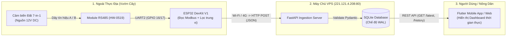

# AI Smart Soil System
> **Hệ thống AIoT Giám Sát và Phân Tích Dinh Dưỡng Đất Nông Nghiệp Thời Gian Thực**  
> Dự án phục vụ theo dõi sức khỏe thổ nhưỡng, tối ưu hóa tưới tiêu và phân bón cho cây trồng.


---

## MỤC LỤC
1. [Tổng Quan Kiến Trúc Hệ Thống](#1-tổng-quan-kiến-trúc-hệ-thống)
2. [Kiến Thức Cơ Bản Cốt Lõi (Core Concepts)](#2-kiến-thức-cơ-bản-cốt-lõi-core-concepts)
   - [Giao tiếp công nghiệp RS485](#giao-tiếp-công-nghiệp-rs485)
   - [Giao thức Modbus RTU](#giao-thức-modbus-rtu)
   - [Bộ lọc trung vị (Median Filter)](#bộ-lọc-trung-vị-median-filter)
   - [REST API & Định dạng JSON](#rest-api--định-dạng-json)
   - [CSDL SQLite với chế độ WAL](#csdl-sqlite-với-chế-độ-wal)
   - [Dịch vụ chạy nền Linux (systemd daemon)](#dịch-vụ-chạy-nền-linux-systemd-daemon)
3. [Luồng Hoạt Động Chi Tiết (End-to-End Workflow)](#3-luồng-hoạt-động-chi-tiết-end-to-end-workflow)
4. [Giải Thích Chi Tiết Các File & Khối Mã Nguồn](#4-giải-thích-chi-tiết-các-file--khối-mã-nguồn)
   - [Firmware ESP32 (`firmware-esp32/`)](#firmware-esp32-firmware-esp32)
   - [Backend API (`backend/`)](#backend-api-backend)
5. [Ý Nghĩa Các Chỉ Số Cảm Biến 7-in-1](#5-ý-nghĩa-các-chỉ-số-cảm-biến-7-in-1)
6. [Tài Liệu API Trực Tuyến & Kiểm Thử](#6-tài-liệu-api-trực-tuyến--kiểm-thử)

---

## 1. Tổng Quan Kiến Trúc Hệ Thống

Hệ thống được thiết kế theo mô hình **Edge-to-Cloud**:
* **Edge Node (Phần cứng tại vườn):** Vi điều khiển **ESP32 DOIT DevKit V1** kết nối với **Cảm biến đất 7 trong 1** thông qua module chuyển đổi tín hiệu **TTL-to-RS485 (HW-0519)**.
* **Cloud Server (Máy chủ đám mây):** VPS Ubuntu 22.04 (`221.121.4.208:80`) chạy ứng dụng **FastAPI (Python)** và cơ sở dữ liệu **SQLite**.
* **Client (Giao diện người dùng):** Ứng dụng đa nền tảng **Flutter** và Web truy vấn dữ liệu đo đạc thời gian thực từ Backend.



---

## 2. Kiến Thức Cơ Bản Cốt Lõi (Core Concepts)

### Giao tiếp công nghiệp RS485
* **Tại sao không dùng Analog, I2C hay SPI thông thường?**
  * Trong môi trường nông nghiệp (ngoài vườn, trang trại), dây nối từ cảm biến về tủ điều khiển thường dài từ vài mét đến hàng chục mét. Các giao tiếp như I2C hay tín hiệu điện áp analog sẽ bị suy hao cực nhanh và nhiễm sóng điện từ làm số đo nhảy loạn xạ.
* **Ưu điểm của RS485:**
  * Sử dụng cặp dây vi sai **A (D+)** và **B (D-)**. Tín hiệu được truyền dựa trên **hiệu số điện thế giữa 2 dây** thay vì so với đất (GND). Nhờ đó, nhiễu tác động đều lên cả 2 dây sẽ tự triệt tiêu lẫn nhau, cho phép truyền xa lên tới **1.200 mét** rất ổn định.

---

### Giao thức Modbus RTU
* Là tiêu chuẩn truyền thông công nghiệp phổ biến nhất thế giới:
  * Hoạt động theo mô hình **Master - Slave**: ESP32 đóng vai trò **Master** (chủ động hỏi), cảm biến đóng vai trò **Slave** (chờ hỏi mới trả lời, ID mặc định là `1`).
  * **Function Code 03 (Read Holding Registers):** Lệnh yêu cầu đọc nội dung các thanh ghi lưu trữ giá trị đo từ địa chỉ `0x0000` đến `0x0006` (7 thanh ghi liên tiếp).
  * **Mã kiểm tra CRC16 (Cyclic Redundancy Check):** Mỗi gói tin truyền qua lại đều kèm mã CRC 2 bytes ở đuôi. Nếu đường truyền bị nhiễu làm sai dù chỉ 1 bit, thư viện sẽ phát hiện và loại bỏ gói tin hỏng ngay lập tức.

---

### Bộ lọc trung vị (Median Filter)
* **Vấn đề thực tế:** Khi cắm que kim loại vào đất hoặc rút ra, bề mặt tiếp xúc cơ học và điện dung đất sẽ tạo ra các **xung nhiễu đột biến tức thời (spikes)**, ví dụ độ ẩm đang 20% tự nhiên nhảy vọt lên 90% trong 0.1 giây rồi tụt về 20%.
* **Cách bộ lọc trung vị xử lý:**
  1. Thay vì chỉ đọc 1 lần, hệ thống đọc liên tiếp **5 mẫu** (cách nhau 150ms).
  2. Sắp xếp 5 số này theo thứ tự tăng dần:
     $$\text{Ví dụ mảng đo: } [20.1,\; 20.3,\; 95.0 \text{ (nhiễu)},\; 20.2,\; 20.0] \xrightarrow{\text{Sắp xếp}} [20.0,\; 20.1,\; \mathbf{20.2},\; 20.3,\; 95.0]$$
  3. Giá trị ở giữa mảng (vị trí số 2) chính là **`20.2`** (Trung vị).
  4. Số đo đột biến `95.0` bị đẩy ra biên và bị loại bỏ hoàn toàn, đảm bảo dữ liệu ghi vào database luôn mịn và chuẩn xác.

---

### REST API & Định dạng JSON
* **JSON (JavaScript Object Notation):** Định dạng văn bản tiêu chuẩn để trao đổi dữ liệu có cấu trúc giữa thiết bị IoT và máy chủ.
  ```json
  {
    "device_id": "ESP32_SOIL_01",
    "moisture": 18.3,
    "temperature": 31.9,
    "ec": 0,
    "ph": 9.0,
    "nitrogen": 0,
    "phosphorus": 0,
    "potassium": 0
  }
  ```
* **HTTP POST:** ESP32 đóng vai trò là HTTP Client, thiết lập kết nối TCP đến máy chủ VPS qua cổng 80 và gửi chuỗi JSON lên endpoint `/api/v1/telemetry/`.
* **Mã phản hồi HTTP 201 (Created):** Server báo hiệu gói tin đã được tiếp nhận, kiểm tra hợp lệ và lưu trữ thành công vào CSDL.

---

### CSDL SQLite với chế độ WAL
* **Vì sao dùng SQLite thay vì MySQL/PostgreSQL cho giai đoạn này?**
  * Tiêu thụ **gần như 0 MB RAM** chạy nền, không cần cài đặt thêm daemon service nặng nề. Toàn bộ dữ liệu nằm gọn trong 1 tệp duy nhất (`soil_system.db`).
* **Chế độ WAL (Write-Ahead Logging):**
  * Mặc định, SQLite dùng cơ chế khóa (locking) khi có lệnh ghi, khiến việc đọc dữ liệu có thể bị chờ.
  * Khi kích hoạt `PRAGMA journal_mode=WAL;`, việc ghi dữ liệu mới được đẩy vào file log tạm trước, cho phép **nhiều tiến trình đọc dữ liệu đồng thời với tiến trình ESP32 đang ghi** mà không bao giờ bị nghẽn hay khóa bảng.

---

### Dịch vụ chạy nền Linux (systemd daemon)
* Giúp server FastAPI tự động chạy ngầm dưới nền hệ điều hành Linux của VPS.
* Khi server khởi động lại (reboot) hoặc khi gặp sự cố, **systemd** sẽ tự động kích hoạt lại server ngay lập tức (`Restart=always`), đảm bảo việc thu thập dữ liệu diễn ra 24/7 không gián đoạn.

---

## 3. Luồng Hoạt Động Chi Tiết (End-to-End Workflow)

Trình tự hoạt động diễn ra theo chu kỳ lặp lại tuần tự:

```text
[BƯỚC 1: KHỞI TẠO (SETUP)]
1. ESP32 khởi động, bật cổng giao tiếp Serial debug (115200 baud).
2. ESP32 cấu hình UART2 (chân GPIO 16 làm RX, chân GPIO 17 làm TX) kết nối module RS485.
3. ESP32 kết nối vào Wi-Fi.

[BƯỚC 2: CHU KỲ ĐO ĐẠC & LỌC NHIỄU (LOOP)]
1. ESP32 gửi frame Modbus RTU (Function 03) qua UART2 hỏi cảm biến 7-in-1.
2. Cảm biến đọc môi trường đất và trả về 14 bytes dữ liệu thanh ghi.
3. ESP32 lặp lại việc lấy mẫu 5 lần liên tiếp.
4. Thuật toán Median Filter sắp xếp và lấy giá trị trung vị của từng chỉ số.

[BƯỚC 3: ĐÓNG GÓI & TRUYỀN DỮ LIỆU LÊN CLOUD]
1. Thư viện ArduinoJson chuyển đổi cấu trúc đo thành chuỗi JSON.
2. ESP32 thực hiện kết nối HTTP POST tới:
   http://221.121.4.208/api/v1/telemetry/
3. Máy chủ FastAPI trên VPS tiếp nhận payload:
   - Pydantic kiểm tra hợp lệ (độ ẩm 0-100%, pH 0-14, ...).
   - SQLAlchemy ghi bản ghi vào bảng telemetry_records trong CSDL SQLite.
4. Server phản hồi về ESP32: HTTP 201 {"status": "success", "record_id": X}.

[BƯỚC 4: HIỂN THỊ & XUẤT DỮ LIỆU]
1. Người dùng mở trình duyệt hoặc ứng dụng di động:
   - GET /api/v1/telemetry/latest -> Xem ngay số đo tức thời mới nhất.
   - GET /api/v1/telemetry/history -> Xem lịch sử vẽ biểu đồ.
   - GET /api/v1/telemetry/export-csv -> Tải toàn bộ dataset về máy tính để huấn luyện AI.
5. ESP32 nghỉ 5 giây và lặp lại chu kỳ mới.
```

---

## 4. Giải Thích Chi Tiết Các File & Khối Mã Nguồn

### Firmware ESP32 (`firmware-esp32/`)

#### 1. `firmware-esp32/platformio.ini`
File quản lý cấu hình nạp và thư viện phụ thuộc của PlatformIO:
* `board = esp32doit-devkit-v1`: Chọn đúng dòng vi điều khiển ESP32 30 chân.
* `framework = arduino`: Sử dụng tập thư viện Arduino C/C++.
* `monitor_speed = 115200`: Tốc độ cổng Serial Monitor để xem log tiếng Việt không lỗi font.
* `lib_deps`: Tự động tải 2 thư viện chuẩn:
  * `bblanchon/ArduinoJson @ ^7.0.0`: Thư viện xử lý chuỗi JSON tốc độ cao, tiêu tốn ít bộ nhớ RAM.
  * `4-20ma/ModbusMaster @ ^2.0.1`: Thư viện gửi/nhận giao thức Modbus RTU và tính toán mã kiểm tra lỗi CRC16.

#### 2. `firmware-esp32/include/config.h`
Nơi tập trung toàn bộ các hằng số cấu hình hệ thống:
* `WIFI_SSID` & `WIFI_PASSWORD`: Tên và mật khẩu mạng Wi-Fi tại nơi thử nghiệm.
* `API_SERVER_URL`: Địa chỉ máy chủ VPS tiếp nhận dữ liệu (`http://221.121.4.208/api/v1/telemetry/`).
* `RS485_RX_PIN 16` & `RS485_TX_PIN 17`: Hai chân phần cứng UART2 trên ESP32 dùng giao tiếp với module RS485 HW-0519.
* `MEDIAN_SAMPLE_SIZE 5`: Số lượng mẫu thu thập cho mỗi chu kỳ lọc trung vị.
* `SEND_INTERVAL_MS 5000`: Chu kỳ gửi dữ liệu (5 giây/lần).

#### 3. `firmware-esp32/src/main.cpp`
Chương trình chính gồm 4 khối chức năng:
* **Khối 1 - `ensureWiFiConnected()`:** Kiểm tra trạng thái Wi-Fi. Nếu mạng bị ngắt (do rớt sóng hoặc modem tắt), hàm này tự động thử kết nối lại mà không làm treo chip.
* **Khối 2 - `readModbusSingleSample()`:**
  * Gọi `node.readHoldingRegisters(0x0000, 7)` để đọc 7 thanh ghi liên tiếp từ cảm biến.
  * Chia tỉ lệ theo chuẩn datasheet:
    * Độ ẩm: `node.getResponseBuffer(0) / 10.0f` (vd: `355` $\rightarrow$ `35.5%`).
    * Nhiệt độ: `(int16_t)node.getResponseBuffer(1) / 10.0f` (hỗ trợ đọc cả nhiệt độ âm).
    * pH: `node.getResponseBuffer(3) / 10.0f` (vd: `68` $\rightarrow$ `6.8`).
    * EC và NPK: Đọc giá trị số nguyên trực tiếp.
* **Khối 3 - `readFilteredSoilData()`:**
  * Thu thập 5 mẫu hợp lệ liên tiếp.
  * Sử dụng thuật toán `std::sort` trong thư viện C++ `<algorithm>` để sắp xếp mảng và lấy phần tử ở vị trí trung vị.
* **Khối 4 - `sendTelemetryToServer()`:**
  * Khởi tạo `JsonDocument` từ ArduinoJson, điền các chỉ số đã lọc sạch.
  * Dùng `HTTPClient` gửi yêu cầu `http.POST` lên VPS qua cổng 80.
  * Báo mã phản hồi (HTTP 201) lên Serial Monitor.

---

### Backend API (`backend/`)

#### 1. `backend/app/core/database.py`
Khởi tạo và quản lý kết nối CSDL:
* Khởi tạo `engine` kết nối file `soil_system.db`.
* Lắng nghe sự kiện kết nối `@event.listens_for(engine, "connect")` để tự động thực thi 2 lệnh PRAGMA tối ưu:
  * `PRAGMA journal_mode=WAL;`: Bật chế độ ghi nhật ký trước.
  * `PRAGMA synchronous=NORMAL;`: Tối ưu hóa tốc độ ghi đĩa an toàn.
* Cung cấp hàm phụ thuộc `get_db()` tự động đóng phiên (session) sau khi API trả kết quả.

#### 2. `backend/app/modules/telemetry/models.py`
Định nghĩa bảng CSDL `telemetry_records` bằng SQLAlchemy ORM:
* Các trường: `id` (khóa chính), `device_id` (mã thiết bị), `moisture`, `temperature`, `ec`, `ph`, `nitrogen`, `phosphorus`, `potassium`, `created_at` (thời gian ghi).
* Đánh chỉ mục hỗn hợp `Index("idx_device_created_at", "device_id", "created_at")` giúp việc tìm kiếm bản ghi mới nhất hoặc xuất lịch sử biểu đồ nhanh chóng ngay cả khi bảng chứa hàng triệu dòng.

#### 3. `backend/app/modules/telemetry/schemas.py`
Xác thực dữ liệu đầu vào bằng Pydantic:
* `TelemetryCreate`: Đảm bảo dữ liệu từ ESP32 gửi lên phải hợp lệ:
  * Độ ẩm: $0.0 \le \text{moisture} \le 100.0$
  * Nhiệt độ: $-40.0 \le \text{temperature} \le 80.0$
  * pH: $0.0 \le \text{ph} \le 14.0$
  * EC: $0.0 \le \text{ec} \le 20000.0$
* Nếu cảm biến bị đứt dây hoặc gửi số âm bất thường, Pydantic sẽ tự động từ chối và báo lỗi mà không ghi dữ liệu sai vào Database.

#### 4. `backend/app/modules/telemetry/router.py`
Định nghĩa 4 endpoint API cốt lõi:
* `POST /api/v1/telemetry/`: Nhận dữ liệu JSON từ ESP32, ghi vào SQLite và trả về `HTTP 201 Created`.
* `GET /api/v1/telemetry/latest`: Truy vấn bản ghi mới nhất của thiết bị để hiển thị lên màn hình điện thoại.
* `GET /api/v1/telemetry/history`: Lấy danh sách 50 hoặc 100 bản ghi gần nhất để vẽ biểu đồ diễn biến dinh dưỡng đất.
* `GET /api/v1/telemetry/export-csv`: Truy vấn toàn bộ cơ sở dữ liệu và truyền trực tiếp (StreamingResponse) về máy tính dưới dạng file `.csv` phục vụ cho việc nghiên cứu và huấn luyện mô hình AI.

#### 5. `backend/main.py`
Điểm khởi chạy máy chủ FastAPI:
* Tự động khởi tạo bảng CSDL khi bật server (`Base.metadata.create_all`).
* Đăng ký middleware **CORS** cho phép các ứng dụng Web Dashboard và App Mobile ở các tên miền khác nhau có thể gọi API mà không bị chặn bảo mật trình duyệt.
* Cung cấp endpoint kiểm tra tình trạng máy chủ `GET /health`.

#### 6. `backend/soil-backend.service`
Tệp cấu hình Systemd Daemon trên Ubuntu VPS:
```ini
[Unit]
Description=AI Smart Soil System Telemetry Backend
After=network.target

[Service]
User=root
WorkingDirectory=/opt/ai-smart-soil-system/backend
ExecStart=/opt/ai-smart-soil-system/backend/venv/bin/uvicorn main:app --host 0.0.0.0 --port 80
Restart=always
RestartSec=5

[Install]
WantedBy=multi-user.target
```
Giữ cho dịch vụ FastAPI chạy liên tục trên cổng 80 của VPS và tự khởi động lại sau 5 giây nếu gặp sự cố.

---

## 5. Ý Nghĩa Các Chỉ Số Cảm Biến 7-in-1

| Chỉ số | Tên tiếng Anh | Đơn vị | Dải đo | Ý nghĩa nông học & Lưu ý |
| :--- | :--- | :--- | :--- | :--- |
| **Độ ẩm** | Soil Moisture | `%` | 0 - 100% | Đánh giá tình trạng thiếu/úng nước. Cây sầu riêng, tràm, rau màu thường cần độ ẩm 60% - 75%. |
| **Nhiệt độ** | Soil Temp | `°C` | -40 - 80°C | Nhiệt độ rễ cây. Nhiệt độ đất quá cao ($> 35^\circ\text{C}$) làm suy yếu hoạt động của vi sinh vật có lợi. |
| **Độ dẫn điện (EC)** | Electrical Conductivity | $\mu\text{S/cm}$ | 0 - 20.000 | Phản ánh **tổng lượng muối khoáng hòa tan** trong dung dịch đất. Dưới 400: đất nghèo kiệt; 500 - 1.500: lý tưởng; trên 2.000: nguy cơ ngộ độc phân, mặn. |
| **Độ pH** | Soil pH | pH | 3 - 9 pH | Thang đo độ chua/kiềm. Đất Đồng Nai thường bị chua (phèn, $\text{pH} < 5.5$) làm cây không hấp thu được lân. Ngưỡng lý tưởng: 6.0 - 7.0. |
| **Nitơ (N)** | Available Nitrogen | mg/kg | 1 - 1.999 | Đạm hòa tan dễ tiêu trong đất. Giúp phát triển thân, lá. *(Được nội suy từ EC)* |
| **Photpho (P)** | Available Phosphorus| mg/kg | 1 - 1.999 | Lân dễ tiêu trong đất. Giúp kích thích bộ rễ phát triển và phân hóa mầm hoa. *(Được nội suy từ EC)* |
| **Kali (K)** | Available Potassium | mg/kg | 1 - 1.999 | Kali dễ tiêu. Tăng khả năng chống chịu sâu bệnh và vận chuyển đường nuôi trái. *(Được nội suy từ EC)* |

> [!IMPORTANT]
> **Hiện tượng que đo ngoài không khí:**
> Cảm biến 7-in-1 tính toán hàm lượng N-P-K dựa trên **độ dẫn điện EC** của nước chứa ion khoáng trong đất. Khi que kim loại để ngoài không khí khô hoặc cắm vào đất khô kiệt (ẩm = 0%), không có dung dịch điện phân nối giữa các que kim $\rightarrow \mathbf{EC = 0} \rightarrow \mathbf{N, P, K = 0}$. Khi cắm ngập vào đất ẩm, dòng điện vi sai chạy qua dung dịch đất và các chỉ số EC, NPK sẽ nhảy lên ngay lập tức.

---

## 6. Tài Liệu API Trực Tuyến & Kiểm Thử

Máy chủ đám mây đang vận hành 24/7 tại địa chỉ công khai:

* **Trang tài liệu tương tác Swagger UI:** [http://221.121.4.208/docs](http://221.121.4.208/docs)
* **Kiểm tra trạng thái server:**
  ```bash
  curl http://221.121.4.208/health
  # Kết quả: {"status":"healthy"}
  ```
* **Lấy bản ghi mới nhất từ ESP32:**
  ```bash
  curl http://221.121.4.208/api/v1/telemetry/latest?device_id=ESP32_SOIL_01
  ```
* **Tải toàn bộ Dataset đo đạc ra file CSV:**
  Truy cập trực tiếp: [http://221.121.4.208/api/v1/telemetry/export-csv](http://221.121.4.208/api/v1/telemetry/export-csv)
